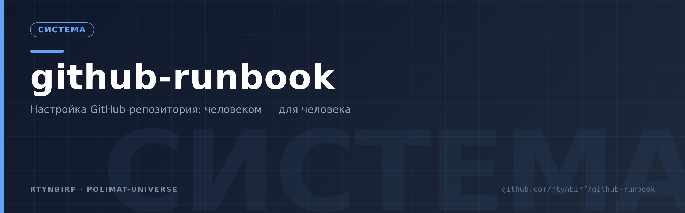

  

  

# GitHub-ранбук: настройка репозитория человеком для человека

> Принцип: **не «нажми сюда», а «вот зачем это нужно»**. Каждый флаг объяснён по-человечески,
> каждая команда — проверена живым запросом к API (журнал верификации — в `SOURCES.md`).
> Всё, что помечено «проверено live», реально исполнено на аккаунте `rtynbirf` 01.11.2026.

## Зачем этот ранбук

GitHub после создания репозитория предлагает ~40 переключателей. Документация объясняет
*что* делает каждый, но не *зачем* и *что выбрать*. Этот мануал закрывает разрыв:
полный обход флагов Settings с решениями «человека» — владельца личного аккаунта,
который работает один и с агентами, на приватных репозиториях, на бесплатном тарифе.

## Карта файлов

| Файл | О чём |
|---|---|
| `01-sozdanie-repo.md` | Создание репозитория: сайт и API, пошагово |
| `02-flagi-settings.md` | **Все** флаги Settings → General по-человечески, с решениями |
| `03-vetki-i-zashchita.md` | Ветки и защита main: Free vs Pro, что реально включить |
| `04-bezopasnost.md` | Dependabot, secret scanning, гигиена токенов |
| `05-api-shpargalka.md` | Проверенные curl-команды на каждый пункт настройки |
| `06-poryadok-i-backapy.md` | Теги, релизы, bundle-бэкапы, правило «всё в репе» |
| `07-organizm-avtonomnost.md` | Органы автономности: CI, AGENTS.md, RESTORE, cron-бэкапы, релизы, issues |
| `SOURCES.md` | Журнал верификации: живые API-тесты и веб-источники |
| `РЕЕСТР-КОСЯКОВ-ИИ-2026-11-09.md` | Реестр косяков/ошибок/промахов ИИ (280 + волна 2026-11-09 + механизм-сессии §10): классы, корни, выводы, запреты, приёмы, чек-лист «ГОТОВО» |

## Быстрый путь: 15 минут на новый репозиторий

1. **Создай private-репо** — сайт: New → имя → Private → Create; API: см. `01`, ответ `201`.
2. **Опиши репо по-человечески**: Settings → General → Description + Topics (`02`).
3. **Выключи шум**: Wiki, Projects, Discussions — OFF, если работаешь через файлы в репо (`02`).
4. **Включи комфорт merge-кнопок**: delete_branch_on_merge, auto-merge, squash-заголовок (`02`).
5. **Безопасность**: Dependabot alerts + automated security fixes — две PUT-команды, ответ `204` (`04`).
6. **Защита main**: на Free для приватного репо недоступна — не трать время, используй
   дисциплину тегов и bundle-бэкапы (`03`); когда будет Pro — одна команда из `03`.
7. **Первый пуш**: `git push -u origin main`, затем тег `v0.1.0`.

## Три правила этого аккаунта (договор с самим собой)

1. **Всё в репе, не в песочнице.** Рабочая машина смертна; репозиторий переживает её.
2. **Токены не печатаются и не хранятся дольше сессии.** Файл с правами 600 в `/tmp`,
   удаление — обязательный финал сессии (`04`).
3. **Чужих агентов не трогать.** Аккаунт общий: работаем только со своими репо,
   visibility чужих не меняем, аккаунт-левел настройки не перекраиваем.

## Правила в исполнении машины

Три правила выше — исполняемый автомат: **[`domovoy-ritual`](https://github.com/rtynbirf/domovoy-ritual)**.
Правило 2 (токены в /tmp, стирание — финал сессии) там буквально командой `clean` с guard-ом G6;
«всё в репе» — пломбой S4 (бандл-дайджест SHA256); ноль уведомлений — таблицей 12 дефолтов устава.
